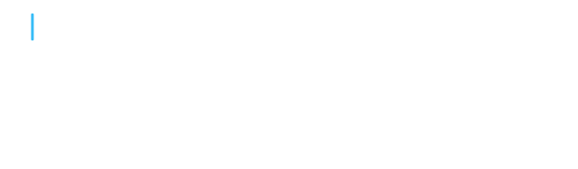
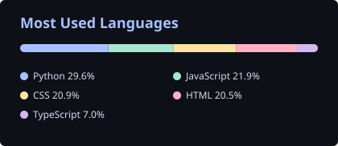
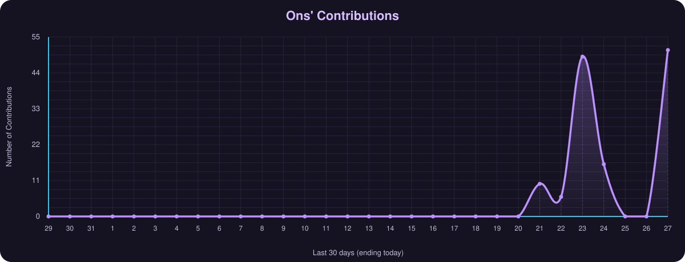

 <!-- Banner (moon) -->


<!-- Self-hosted typing animation (file: assets/typing.svg) -->
<div align="center">
  
</div>

<div align="center">
  
  
  
</div>

<br/>

<div align="center">
  <a href="https://www.linkedin.com/in/rekik-ons"></a>
  <a href="mailto:onsrekik9@gmail.com"></a>
  <a href="https://ons-rekik-portfolio-tau.vercel.app/"></a>
</div>

<br/>


```ts
const onsRekik = {
  role: "Dev Full-Stack · Mobile · IA & Data",
  focus: ["Full-Stack", "Mobile", "Artificial Intelligence"],
  interests: [
    "AI & Data Science",
    "Machine Learning",
    "Computer Vision",
    "Business Intelligence"
  ],
  mindset: "Always curious",
  status: "Open to opportunities"
};

export default onsRekik;
```

- 🔭 Currently working on **kinematic analysis of human movement with Computer Vision**
- 🌱 Deepening my knowledge of **Machine Learning, Deep Learning and LLMs**
- 🎯 Looking for: **PFE internship · Freelance · Project contributions**


<div align="center">


<br/><br/>

<br/>


<br/>


<br/><br/>

<br/>


<br/>


<br/><br/>

<br/>


<br/><br/>


<br/><br/>

<br/>


<br/><br/>


<br/><br/>

<br/>


</div>


<div align="center">
  
  
</div>

<div align="center">
  
</div>


<div align="center">
  
</div>

</div>


<div align="center">
  
</div>


<div align="center">
  <b>A PFE internship, an interesting project, a tech talk? I'd love to exchange ideas with you.</b>
  <br/><br/>
  <a href="mailto:onsrekik9@gmail.com"></a>
  <a href="https://www.linkedin.com/in/rekik-ons"></a>
  <a href="https://ons-rekik-portfolio-tau.vercel.app/"></a>
</div>


